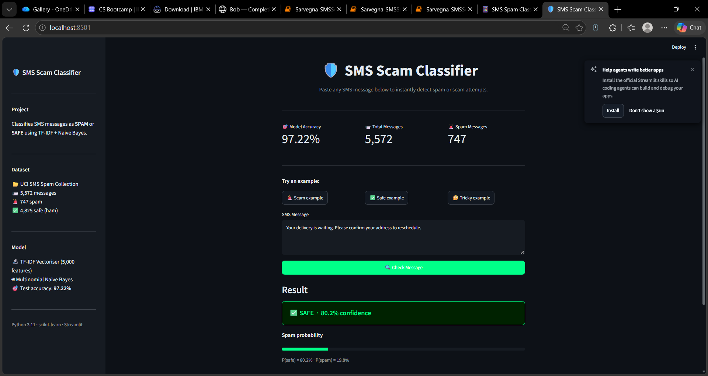

# 🛡️ SMS Spam / Scam Classifier

A beginner-friendly machine-learning project that detects spam and scam SMS messages using **TF-IDF** text features and a **Naive Bayes** classifier. Includes both a Jupyter notebook for step-by-step learning and an interactive Streamlit dashboard.

---

## Description

Every day, millions of people receive spam or scam text messages. This project builds a simple but effective classifier that reads an SMS and decides whether it is **spam/scam** or **safe (ham)**. The model is trained on a real-world dataset of 5,572 labelled messages and achieves over 97% accuracy.

The project is structured so a beginner can follow along in the notebook, and then use the dashboard to test messages interactively.

---

## Features

- Loads and explores the UCI SMS Spam Collection dataset
- Cleans and prepares the data with pandas
- Converts text to numbers using **TF-IDF vectorisation**
- Trains a **Multinomial Naive Bayes** classifier
- Evaluates the model with accuracy, precision, recall, F1, and a confusion matrix
- Interactive **Streamlit dashboard** with a dark cybersecurity theme
- Example message buttons (scam, safe, tricky) to try the classifier instantly
- Sidebar showing dataset stats and model accuracy
- Confusion matrix chart inside an expandable panel

---

## Technologies Used

| Library | Version | Purpose |
|---|---|---|
| Python | 3.11 | Programming language |
| pandas | 3.0.6 | Data loading and manipulation |
| scikit-learn | 1.9.1 | TF-IDF vectoriser, Naive Bayes, evaluation metrics |
| matplotlib | 3.11.2 | Confusion matrix chart |
| streamlit | 1.66.0 | Interactive web dashboard |
| notebook | 7.2.0 | Running the Jupyter notebook |
| ipykernel | 6.29.4 | Python kernel for Jupyter |

---

## Dataset

**UCI SMS Spam Collection**  
🔗 https://archive.ics.uci.edu/ml/datasets/SMS+Spam+Collection

- **5,572 real SMS messages**, each labelled as *spam* or *ham* (safe)
- **747 spam** messages (~13.4%) and **4,825 ham** messages (~86.6%)
- Tab-separated text file, no header row
- Stored locally as `data/sms_spam.csv`

---

## Project Structure

```
sms scam analyser/
├── .streamlit/
│   └── config.toml                   # Dark theme settings for Streamlit
├── data/
│   └── sms_spam.csv                  # UCI SMS Spam Collection dataset
├── screenshots/
│   ├── dashboard.png                 # Screenshot of the Streamlit dashboard
│   └── notebook.png                  # Screenshot of the Jupyter notebook
├── app.py                            # Streamlit dashboard
├── requirements.txt                  # All required Python libraries
├── Sarvegna_SMSScamClassifier.ipynb  # Step-by-step Jupyter notebook
└── README.md                         # This file
```

---

## Setup Instructions

**1. Make sure Python 3.11 is installed**

```bash
py -3.11 --version
```

**2. Install all required libraries**

```bash
py -3.11 -m pip install -r requirements.txt
```

**3. Confirm the dataset is in place**

The file `data/sms_spam.csv` should already be present. If not, download the dataset from the UCI link above, rename the extracted file to `sms_spam.csv`, and place it in the `data/` folder.

---

## How to Run

### Option A — Jupyter Notebook (step-by-step walkthrough)

```bash
py -3.11 -m jupyter notebook Sarvegna_SMSScamClassifier.ipynb
```

The notebook opens in your browser. Run each cell top-to-bottom with **Shift + Enter**.

### Option B — Streamlit Dashboard (interactive app)

```bash
py -3.11 -m streamlit run app.py
```

The dashboard opens automatically at **http://localhost:8501**.

---

## Results

| Metric | Value |
|---|---|
| **Test accuracy** | 97.22% |
| **Precision (spam)** | ~99% |
| **Recall (spam)** | ~83% |
| **F1 score (spam)** | ~90% |

### Confusion Matrix (test set — 1,115 messages)

```
                Predicted Safe   Predicted Spam
Actual Safe            963               2
Actual Spam             29             121
```

- **963** safe messages correctly identified
- **121** spam messages correctly caught
- **2** safe messages incorrectly flagged as spam (false positives)
- **29** spam messages missed (false negatives)

The model is very conservative about calling something spam — it rarely flags a real message as spam, but misses about 1 in 6 actual spam messages. This is a sensible trade-off for a spam filter.

---

## Screenshots

> Add screenshots of your running app to the `screenshots/` folder and they will appear here.

### Streamlit Dashboard


### Jupyter Notebook


---

## Limitations and Future Scope

**Current limitations:**
- The model only uses word-level TF-IDF features — it cannot understand context or sentence meaning
- Trained on English SMS messages from one dataset; may not generalise well to other languages or modern scam styles
- Naive Bayes assumes all words are independent of each other, which is not always true

**Ideas to improve it:**
- Try other classifiers: `LogisticRegression`, `LinearSVC`, or a neural network
- Add word-pair features with `ngram_range=(1, 2)` in the TF-IDF vectoriser
- Use a pre-trained language model (e.g. BERT) for much better understanding of message meaning
- Train on a larger, more recent dataset that includes newer scam patterns
- Add support for multiple languages

---

## Author

**Sarvegna**

Built as a beginner machine-learning project using Python 3.11, scikit-learn, and Streamlit.
